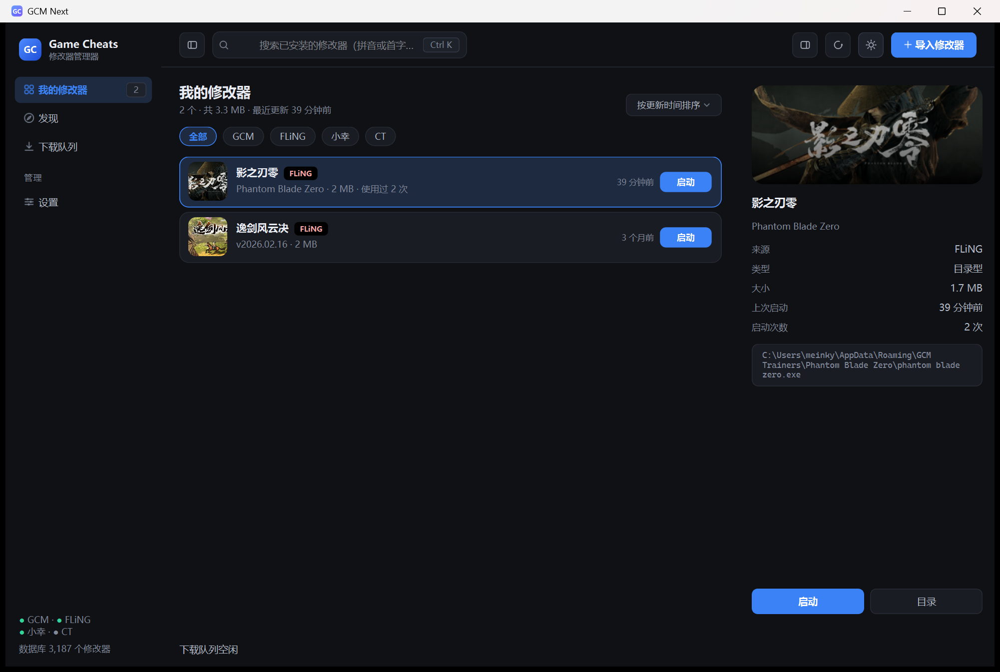
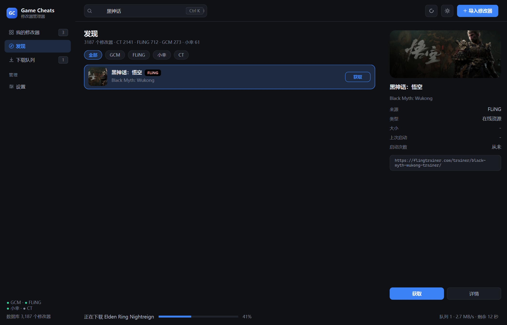
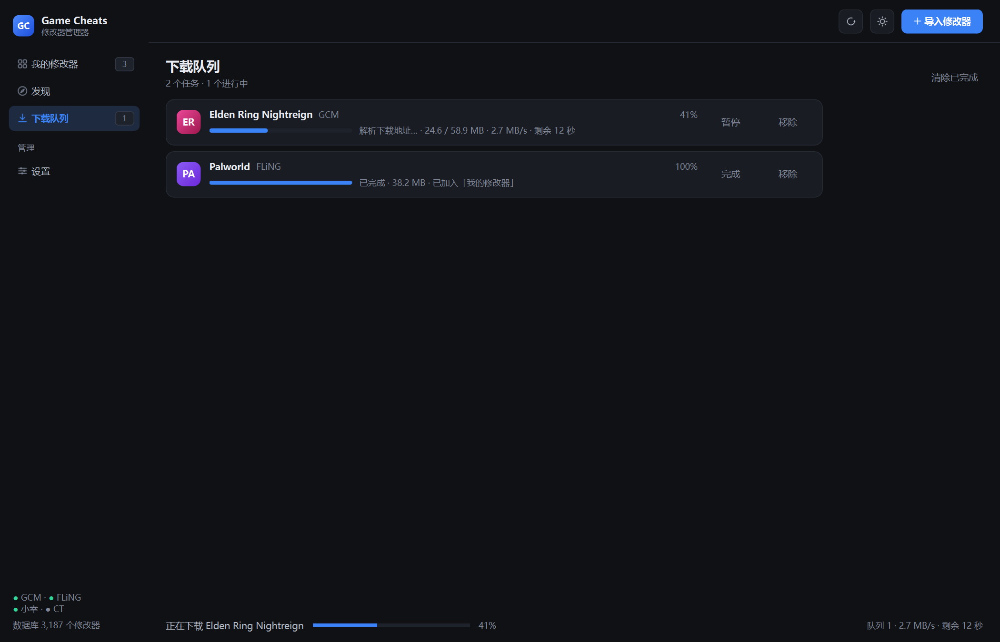
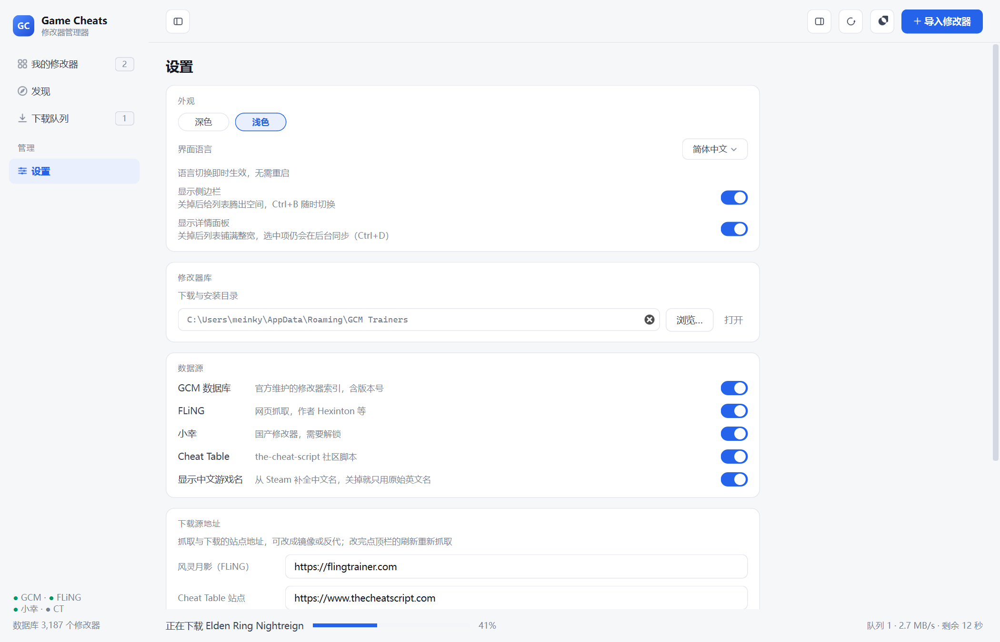
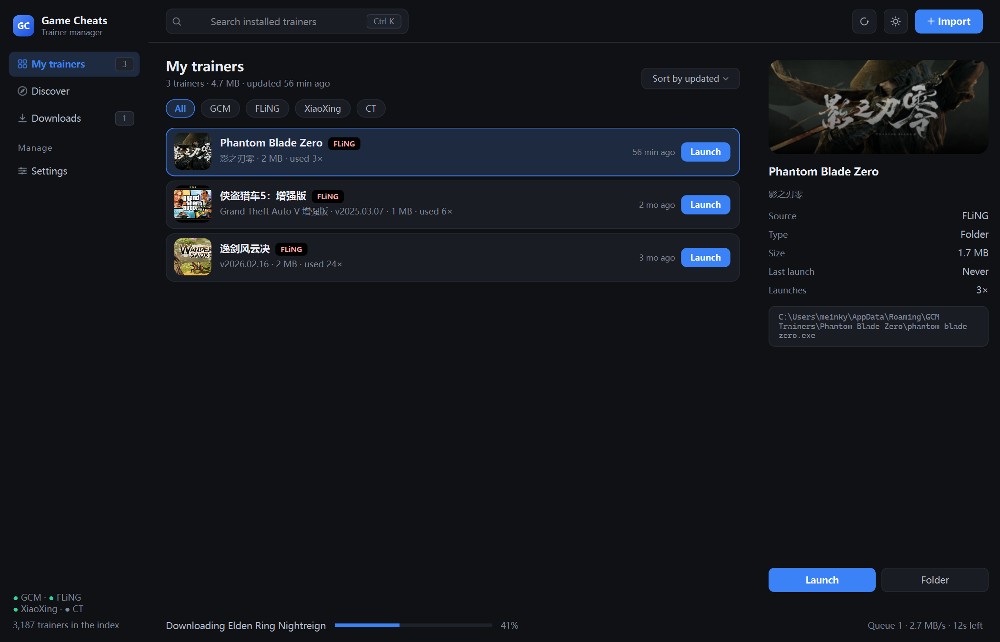

<p align="center">
  
</p>

<p align="center">
  
  <a href="LICENSE.txt"></a>
  
  
  
</p>

<p align="center">
  <a href="#下载与安装">下载与安装</a> ·
  <a href="#功能">功能</a> ·
  <a href="#使用">使用</a> ·
  <a href="#常见问题">常见问题</a> ·
  <a href="#数据来源与索引">数据来源</a> ·
  <a href="#从源码构建">从源码构建</a> ·
  <a href="#与原项目的关系">与原项目的关系</a>
</p>

**GCM Next** 把单机游戏修改器的「找、下、装、启动」收进一个窗口。

它只做这一件事，所以干脆：四个公开站点合成一个 3187 条的库，条目自动补上 Steam 封面与中文名，点「获取」就下载、解压、装进本地目录，之后在列表里点「启动」——没有内嵌浏览器，没有安装程序，没有后台常驻进程，一个 exe 加一个资源文件夹。

联机游戏、修改器制作、内存调试、云同步、账号体系一概没有，只保留「搜到 → 装上 → 启动」。

本项目是 [Game Cheats Manager](https://github.com/dyang886/Game-Cheats-Manager)（GPL-3.0）的衍生作品：界面、状态层、主题、翻译与下载管线全部重写，但刻意沿用它定义的目录约定与数据结构，所以**已有的修改器与索引库可以直接认**，详见 [与原项目的关系](#与原项目的关系)。当前版本 **0.1.0**。

---

## 界面

<p align="center">
  
  <br>
  <em>我的修改器 —— 52px 封面、来源徽章、作者 · 版本 · 大小 · 用过几次，右侧是详情与启动</em>
</p>

<p align="center">
  
  <br>
  <em>发现页 —— 英文条目自动补中文名，搜「黑神话」「影之刃零」都能直接命中</em>
</p>

<p align="center">
  
  <br>
  <em>下载队列 —— 解析、续传、解压、入库，每个阶段都写在行里</em>
</p>

<p align="center">
  
  
  <br>
  <em>左：设置页（浅色，库目录可直接编辑）　　右：英文界面（副标题仍保留中文，方便对照）</em>
</p>

---

## 功能

### 我的修改器

- **扫的是真实目录**：默认 `%APPDATA%\GCM Trainers`（与旧版同一个位置）。目录里是文件夹就读 `gcm_info.json` 决定入口 exe，是散装文件就直接列出来
- **卡片而不是文件名**：封面、中/英双标题、来源徽章、作者、版本、大小、用过几次、上次启动时间
- **封面来自 Steam**：按名字查 `storesearch` 拿 appid 与中文名，`appdetails` 拿 `header_image`，图片落在 `covers\<appid>.jpg`；查不到就退回按名字哈希的渐变色块 + 首字母，**界面不会等网络**
- **搜索是三层**：子串 → 拼音首字母（`hshwk` 能搜到「黑神话：悟空」）→ 三个字以上走 rapidfuzz 模糊匹配
- **排序**：按更新时间 / 按名称，两个列表各自记住自己的选择
- **启动**：拉起入口 exe，并给这个条目 +1 次使用计数（`usage.json`）
- **删除进回收目录**：移到 `%APPDATA%\GCM Next\trash\`，不真删；移的是安装目录里的**顶层条目**，不会留下空壳文件夹

### 发现

- **四源合库 3187 条**：本地旧库 273 + FLiNG 712 + the-cheat-script 2141 + 小幸 61
- **分源缓存**：每个源抓完就写 `cache\<源>.json`，下次启动先用缓存再后台刷新；三个站点地址都可改成镜像或反代
- **按源过滤**：四个开关各自控制索引与条目，关掉小幸，那 61 条一起消失
- **中文搜索兜底**：搜到中文但本地无匹配时，会拿这个词问一次 Steam，把结果写回索引再筛一遍；启动后还有一轮后台补全（前 300 条），补齐后「黑神话」这类部分词也能命中
- **三种动作**：FLiNG 条目「获取」进下载队列，CT 条目「获取」解析 Yandex 直链下载，小幸与 GCM 条目「网页」打开官方页面

### 下载与安装队列

- **真实下载**：解析下载页拿直链（FLiNG 必须带 `Referer`，否则最后一跳 403）→ `Range` 续传 → 落盘 → 按内容判定后缀
- **暂停 / 继续 / 重试 / 移除**：暂停后已下载的字节保留，继续时从断点接着下；重试沿用同一个临时文件
- **解压与安装**：zip / 7z / rar 交给随包内置的 7-Zip（用户不必自装），zip 走自带实现并做 zip-slip 校验；装完写 `gcm_info.json`，自动出现在「我的修改器」
- **并发 2**：同时最多两个任务在下载，其余排队；底部常驻队列条汇总总速度与剩余时间
- **失败说得清**：403/404 提示「来源可能已失效」，Yandex 429 提示「过几分钟再试或打开官方页面」，解压失败回显 7-Zip 的原话

### 外观

- **主题由 token 生成**：一套颜色/圆角/间距/字号拼出整份 QSS，业务代码里没有一处内联样式
- **深浅色实时切换**：换样式表后对已在场的控件逐个 `setPalette` + `unpolish/polish`（约 95ms），原生标题栏跟着 `DwmSetWindowAttribute` 一起变色
- **两侧面板可收起**：`Ctrl B` 收左栏、`Ctrl D` 收详情，列表最多拿到 1400px；收起后导航改由顶栏按钮的菜单提供
- **图标全是现画的**：QPainter 在 24 单位坐标系里画再缩放，不依赖任何 PNG，颜色随主题传参

### 语言

- **简体 / 繁体 / 英文热切换**，不需要重启：中文原文做键，切语言时整棵控件树重建并恢复当前页与搜索词
- 英文界面主标题用英文名、副标题保留中文名，中文界面反过来——两边都对得上

### 本地数据

全部在 `%APPDATA%\GCM Next\`：

| 文件 / 目录 | 内容 |
|---|---|
| `settings.json` | 主题、语言、库目录、数据源开关、源地址、面板状态、窗口尺寸 |
| `usage.json` | 每个修改器的启动次数与上次启动时间 |
| `cache\` | `fling.json` / `ct.json` / `xiaoxing.json` / `steam.json`，删掉即重新抓取 |
| `covers\` | `<appid>.jpg`，Steam 封面缓存 |
| `tmp\` | 下载中的 `.part` 临时文件，可随时清空 |
| `trash\` | 删除的修改器，误删可找回 |

---

## 下载与安装

程序是 onedir 形态：一个 `GCM Next.exe` 加一个 `_internal` 资源目录，**解压即用，没有安装过程**。

| 获取方式 | 体积 | 说明 |
|---|---|---|
| **发布包**（`GCM Next.zip`） | 约 77 MB | 自带 Python 运行时与 7-Zip，**推荐** |
| 源码运行 | — | 需要 Python 3.10+ 与 PyQt6，见 [从源码构建](#从源码构建) |

1. 把压缩包解压到任意**可写**目录（例如 `D:\Tools\GCM Next\`）——**整个文件夹一起**，不要只拿走 exe
2. 双击 `GCM Next.exe`
3. 首次启动会扫描 `%APPDATA%\GCM Trainers`，同时在后台抓取四个源的索引；「发现」页右上角的刷新按钮可以手动重抓

**系统要求**：Windows 10 / 11 x64。发布包自带运行时，不需要装 Python，也不需要装 7-Zip。

> 发布包未签名，Windows 会提示「未知发布者」，选择「仍要运行」即可。程序也确实会下载并解压可执行文件，行为上容易被启发式引擎盯上。

**升级**：退出程序，用新的 `GCM Next` 文件夹覆盖旧的。设置、索引缓存与封面都在 `%APPDATA%\GCM Next\`，不会丢。

**卸载**：删掉程序文件夹即可；想清干净就把 `%APPDATA%\GCM Next\` 一起删掉。**注意**：默认下载目录 `%APPDATA%\GCM Trainers` 是旧版共用的，删之前确认里面没有要留的修改器。

---

## 使用

### 快捷键

| 快捷键 | 作用 |
|---|---|
| `Ctrl K` | 聚焦搜索框 |
| `F5` | 重新抓取在线索引（四个源） |
| `Ctrl 1` … `Ctrl 4` | 我的修改器 / 发现 / 下载队列 / 设置 |
| `Ctrl B` | 收起 / 展开左侧导航 |
| `Ctrl D` | 收起 / 展开右侧详情 |

### 四个页面

| 页面 | 说明 |
|---|---|
| 我的修改器 | 左侧封面与标题，右侧时间 + 启动；右上角切换排序；右键「启动 / 打开目录 / 删除」；顶栏「导入修改器」可导入 zip 或单个文件 |
| 发现 | 四个来源胶囊过滤；右侧详情底部三态：`获取`（可下载）/ `网页`（只能开官方页）/ `详情`（无下载地址） |
| 下载队列 | 每行可暂停 / 继续 / 移除；「清除已完成」只清列表，不动已装好的文件 |
| 设置 | 改动即时生效并写盘，没有「应用」按钮 |

### 设置项

| 分组 | 能改什么 |
|---|---|
| 外观 | 深色 / 浅色；「显示侧边栏」「显示详情面板」（等同 `Ctrl B` / `Ctrl D`） |
| 界面语言 | 简体中文 / 繁體中文 / English，选了就换，不用重启 |
| 修改器库 | 下载与安装目录：**可直接手输**，支持 `%APPDATA%` 这类变量与 `~`，回车后自动建目录、同步队列目标并刷新列表；非法路径红字提示并退回上一个 |
| 数据源 | GCM / FLiNG / 小幸 / Cheat Table 四个开关；「显示中文游戏名」总开关（关掉就只用原始英文名） |
| 下载源地址 | 三个站点的 base 地址，可换镜像或反代；「恢复默认地址」一键还原 |

### 目录约定

- **安装目录**：`%APPDATA%\GCM Trainers\<游戏名>\`，里面是入口 exe（或 `.ct`）与 `gcm_info.json`
- **目录型修改器**：`gcm_info.json` 的 `extension` 写 `"none"`，启动时打开整个目录（有些训练器要带资源文件）
- **导入**：`.zip` 解到与包同名的文件夹，其它文件直接复制；重名会跳过并在结束时的 Toast 里汇总

---

## 常见问题

**杀毒软件报毒 / SmartScreen 拦截？**
发布包是 PyInstaller 打的，没有签名，误报很常见；程序本身也确实会下载并解压可执行文件，行为上容易被启发式引擎注意。介意就用源码运行或自行构建，代码全在这里。

**搜中文搜不到？**
先确认设置里「显示中文游戏名」是开的。中文名来自 Steam，需要联网补；新装的、冷门的条目可能还没补上，此时用英文名或拼音首字母能搜到。搜到中文但没结果时程序会自动问一次 Steam 并把结果写回，稍等一秒再搜即可。

**封面不出来 / 一直是色块？**
Steam 搜索是**整词匹配**：`黑神话` 搜不到，`黑神话：悟空` 才行；名字差太多（中文名对不上英文名）也会查不到。查不到时保持渐变 + 首字母，不影响使用。网络不好时首屏可能慢几秒，拿到就替换。

**发现页 GCM 条目的「获取」为什么点不动？**
GCM 官方源的下载走私有签名服务，本仓库不含密钥，所以这类条目只能「打开网页」。能力对照见 [数据来源](#数据来源与索引)。

**CT 条目下载失败，提示 429？**
the-cheat-script 的文件放在 Yandex 网盘，换直链的接口按出口 IP 限流。过几分钟再点「重试」，或用「详情」打开官方页面手动下。

**小幸的条目为什么只能打开网页？**
它的下载链接在 MediaFire / 百度网盘：前者对脚本直接 403，后者要登录。所以这里只做索引与跳转。

**下载卡在「解析下载地址」？**
这一步要访问站点与网盘接口，网络不畅时重试三次（间隔递增）。仍失败就再点一次重试，或换个源。队列里的「移除」会同时取消后台任务。

**删掉的修改器还能找回来吗？**
可以。删除只是移到 `%APPDATA%\GCM Next\trash\`，按时间戳命名，手动移回 `GCM Trainers` 即可。

**支持哪些游戏？**
索引里有什么就能搜到什么，目前 3187 条。想要新条目就等对应站点更新后点 `F5`。

**能用在联机游戏吗？**
不建议，也不支持，见下面的免责声明。

---

## 数据来源与索引

这一节解释「条目从哪来、为什么有的能下有的不能」。只想用的话可以跳过。

### 四个来源

| 来源 | 接口 | 条目数 | 下载 |
|---|---|---|---|
| FLiNG | `flingtrainer.com/all-trainers/` 的 HTML 索引 + 每个训练器页里的 `/downloads/<token>` | 712 | ✅ 直链；必须带 `Referer: https://flingtrainer.com/`，否则最后一跳 403 |
| the-cheat-script | Blogger 的 Atom/JSON feed：`/feeds/posts/default?alt=json&max-results=150` | 2141 | ⚠️ 文章里的 Yandex Disk 公共链接，经 `cloud-api.yandex.net` 换直链；接口按 IP 限流（429） |
| 小幸 | WordPress REST：`/wp-json/wp/v2/posts?per_page=100` | 61 | ❌ 正文只给 MediaFire / 百度网盘，只打开官方页 |
| GCM 旧库 | 读本地 `%APPDATA%\GCM Settings\db\gcm_trainers.json` | 273 | ❌ 官方源走私有签名服务，本仓库不含密钥 |

三个站点的地址都能在设置里替换，抓取函数接受一个 `base` 参数：

```
FLiNG    {base}/all-trainers/
CT       {base}/feeds/posts/default
小幸      {base}/wp-json/wp/v2/posts
```

### 旧库清洗

旧版索引里混着历史问题，读入时做三件事：按名字小写去重、跳过名字是 `none` 的空记录、去掉作者名里已经损坏的 `U+FFFD` 替换字符（这些字符在旧库写入时就坏了，无法还原，只能清理）。`official_url` 只有以 `http` 开头时才当作详情链接，否则会显示成一串相对路径。

### 中文名与封面是怎么补的

Steam 的两个公开接口：`storesearch` 用 `l=schinese&cc=cn` 搜一次就能同时拿到 appid、中文名与封面地址；`appdetails` 再用另一种语言取一次，凑齐中英双名。

难点是**整词匹配**：`黑神话` 搜不到，`黑神话：悟空` 才行。所以中文名不靠现场查询，而是维护一份本地索引：

| 层 | 做法 | 作用 |
|---|---|---|
| 种子 | 随包带 `gcm/data/steam_seed.json`（44 个热门游戏的中英名 + appid + 封面地址） | 断网也能搜到这些，首次启动即可见 |
| 后台 | 启动后取前 300 条没有中文名的条目，串行补（限速 0.18s，每 8 条落一次盘） | 逐步覆盖全库 |
| 急队列 | 列表里可见的行、以及「搜中文没结果」的那一次，插队处理 | 眼前的操作先响应 |

超时**不写否定缓存**（否则一次网络抖动会让这个词 6 小时内都查不到）；真的查不到才缓存，6 小时内不重试。

### 为什么 GCM 源不能下

上游的下载地址由 `get_signed_download_url()` 生成，签名端点来自一个不入库的 `secret_config`；该模块缺失时端点为空串并抛 `RuntimeError('Request signing is unavailable in this build')`。所以本版本对 GCM 条目只做索引与「打开网页」，不会假装能下。

### 边界

- 站点改版会让解析器失效，表现是条目数骤降或「获取」报错，需要更新 `gcm/data/sources/*.py`
- CT 的限流与出口 IP 绑定，换网络可能立刻恢复
- 索引里没有的、或名字与商店名差太远的游戏，补不到中文名与封面

---

## 已知限制

- **只支持 Windows**：用了 `%APPDATA%` 目录约定、`DwmSetWindowAttribute` 改标题栏、随包的 `7z.exe`；Qt 部分理论上可移植，但没有测试
- **GCM 官方源不能下载**（原因见上一节），小幸只能开网页
- **CT 下载受 Yandex 限流影响**，高峰期需要重试
- **没有自动更新、没有开机自启、没有多线程分段下载**：并发固定 2，单任务顺序续传
- **中文名与封面依赖 Steam**：查不到就退回英文名 + 渐变块，冷门条目可能一直没中文名
- **发布包未签名**，Windows 会提示「未知发布者」
- **界面只有三种语言**，繁体是人工转换，个别术语可能与地区习惯不同
- **没有日志文件**：出问题靠界面提示与复现步骤；开发期用 `tools/` 下的冒烟与端到端脚本定位

---

## 从源码构建

需要 **Python 3.10+**（开发环境 3.12）与 Windows。

```bat
:: 1) 直接跑（首次自动建虚拟环境并装依赖）
run.bat

:: 2) 手动跑
python -m venv .venv
.venv\Scripts\python.exe -m pip install -r requirements.txt
.venv\Scripts\python.exe main.py

:: 3) 打包（onedir）
.venv\Scripts\python.exe tools\make_icon.py     :: 改了 Logo 才需要重新生成
.venv\Scripts\python.exe tools\build.py         :: 输出 dist\GCM Next\GCM Next.exe
```

> 用 **onedir 而不是 onefile**：Qt 不必每次启动解压到临时目录，冷启动快，杀软误报也少。构建末尾会剪掉 `opengl32sw.dll`（19.7 MB，软件 OpenGL）、`Qt6Pdf.dll`、`Qt6Network.dll`——界面全是 raster 绘制，用不到；剪完实测启动、渲染与下载安装链路都正常。所以产物是 **77 MB** 而不是 103 MB。

`tools/` 下是开发期工具，不参与打包：`smoke.py`（54 项无窗口冒烟）、`e2e.py`（真实下载 + 安装 + 暂停续传）、`shot.py` / `grab_window.py`（截图）、`scan_i18n.py`（扫漏翻的中文）、`build.py`（打包）。

## 项目结构

```
main.py                        入口（from gcm.bootstrap import run）
gcm/
  bootstrap.py                 组装 AppContext → MainWindow → app.exec
  context.py                   共享上下文：设置 / 主题 / 已安装 / 在线库 / 队列 / Steam 补全
  paths.py                     数据目录、旧版目录约定、随包资源定位
  settings_store.py            JSON 设置 + changed 信号
  i18n.py                      三语词表（中文原文为键）+ 语言热切换
  util.py                      humanize / fmt_size / initials
  theme/
    tokens.py                  深浅两套 token（颜色、圆角、间距、字体、徽章、封面渐变）
    qss.py                     由 token 生成整份 QSS
    manager.py                 换样式表 + palette + 全树重刷
  data/
    trainer.py                 统一数据模型（本地 / 在线共用）
    installed.py               扫描、启动、删除、使用计数
    catalog.py                 多源抓取、分源缓存、合并去重、开关过滤
    sources/                   fling / ct / xiaoxing 三个源的解析器
    steam.py                   名字 → appid / 中英双名 / 封面（带缓存）
    enrich.py                  后台补全线程（串行、限速、急队列）
    downloader.py              Range 续传 + 进度 / 阶段信号
    installer.py               解压、zip-slip 校验、入口 exe 选择、写 gcm_info.json
    downloads.py               队列：并发 2、暂停 / 继续 / 重试 / 取消
    search.py                  子串 → 拼音首字母 → 模糊
  net/http.py                  带 UA / Cookie 的请求封装（gzip、Content-Disposition）
  ui/
    icons.py                   QPainter 现画的矢量图标
    sidebar.py                 左侧导航（可收起）
    topbar.py                  搜索、刷新、主题、两侧面板开关、导入
    main_window.py             四页装配、快捷键、导入 / 删除 / 打开网页
    widgets/                   trainer_list（模型 + 自绘委托）、detail_panel、queue_bar、search_field、switch、toast
    pages/                     library / discover / downloads / settings
tools/                         冒烟、端到端、截图、i18n 扫描、图标与打包脚本
assets/                        现画的图标与 app.ico
vendor/7z/                     随包分发的 7-Zip（LGPL）
docs/shots/                    界面截图
```

## 文档

- [开发笔记（docs/DEV.md）](docs/DEV.md) —— 模块清单、设计系统、与旧版的逐项对比、每个坑的成因
- [分享文案（docs/SHARE.md）](docs/SHARE.md) —— 发布说明、短贴与配图建议
- [许可证（LICENSE.txt）](LICENSE.txt) —— GPL-3.0 全文

## 与原项目的关系

本项目是 [Game Cheats Manager](https://github.com/dyang886/Game-Cheats-Manager)（GPL-3.0）的重写，参照的是它的 **2.3.2** 版。

**直接复用的**

- **目录约定**：`%APPDATA%\GCM Trainers` 的位置、`gcm_info.json` 的字段与 `extension` 语义
- **旧索引格式**：`%APPDATA%\GCM Settings\db\gcm_trainers.json` 的字段（`game_name` / `origin` / `author` / `version` / `official_url` / `gcm_url` / `extension`）
- **站点与产品形态**：四个来源的划分、三种动作（获取 / 网页）的取舍

**改掉的**

| 旧版 | 这里 | 代价 |
|---|---|---|
| 两个搜索框 + 菜单栏 | 单窗口四页导航 + 可收起侧栏 | 页面变多，需要一次导航 |
| 模块级全局 `settings` 字典，88 处直接读写 | `SettingsStore` + 数据层信号 | 多一层间接 |
| 两份约 290 行、结构重复的 QSS | token 生成的单份模板 | 新颜色必须先加成 token |
| gettext `.po/.mo`，改语言要重启 | 单文件词表 + 整树重建 | 切换时重建控件树（约几十毫秒） |
| 下载进度伪造成列表项，开始下载就清空结果 | 独立队列 + 常驻队列条 | 多一个页面 |
| 已安装侧只有文件名 | 封面、中文名、版本、使用次数 | 首屏可能要等 Steam 几秒 |

**新写的**

界面层（侧栏、顶栏、四页、模型 + 自绘委托的卡片列表、详情面板、队列条、Toast）、设计系统（token → QSS → 主题热切换）、
状态层（SettingsStore / AppContext / 已安装索引 / 使用计数 / 回收目录）、下载管线（续传、暂停、重试、解压安装）、
Steam 补全（缓存、种子、后台与急队列）、多源索引（分源缓存、开关过滤、源地址可替换）、i18n 与打包脚本。

**第三方依赖**

PyQt6（GPL-3.0 例外条款）、pypinyin（MIT）、rapidfuzz（MIT）、随包的 7-Zip（LGPL）。
修改器索引与文件来自 FLiNG、the-cheat-script、小幸的公开页面；游戏名称与封面来自 Steam 商店公开接口。

## 致谢

- [Game Cheats Manager](https://github.com/dyang886/Game-Cheats-Manager) —— 本项目的来源：目录约定、数据结构与整体产品形态
- [FLiNG Trainer](https://flingtrainer.com/)、[the-cheat-script](https://www.thecheatscript.com/)、[小幸修改器](https://www.xiaoxingjie.com/) —— 修改器索引与文件
- Steam 商店接口 —— 游戏中文名与封面
- 7-Zip —— 解压 `.7z` / `.rar`

## 许可

GPL-3.0，见 [LICENSE.txt](LICENSE.txt)。沿用上游的许可与署名。

索引与封面来自各自的公开站点，**修改器版权归各自作者所有**；本项目只做检索、下载搬运与本地管理，不提供破解、绕过付费或二次分发。抓到的封面图版权属于 Steam 与游戏厂商。

## 免责声明

- 仅供**单机游戏**使用；请勿用于联机游戏或违反游戏服务条款的场景
- 使用风险自负：修改游戏内存可能导致存档损坏、成就失效、被反作弊判定
- 下载后请自行确认文件来源与安全性，本程序不对第三方修改器的行为负责

## 反馈

- **Bug / 建议**：到 [Issues](https://github.com/me1nky1225/GcGame-Next/issues) 提，写清系统版本、用的是哪个源、复现步骤，附截图最好
- **改了代码**：直接发 Pull Request，说明动机与验证方式；能跑一遍 `tools/smoke.py` 更省事
